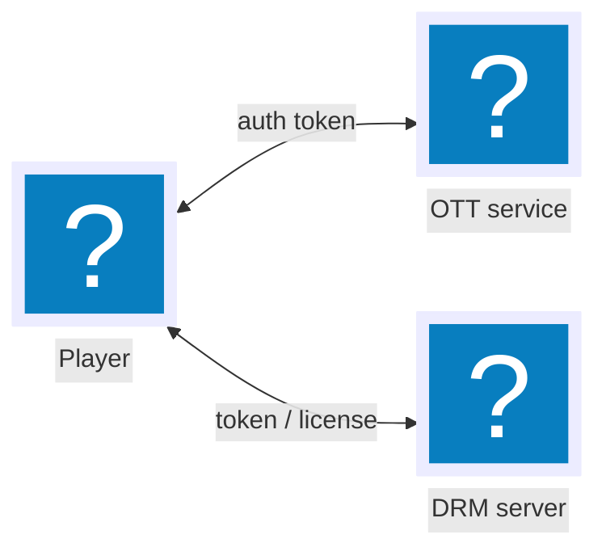

# pele-animate

Animated, illustrated SVG scenes from plain Mermaid code. A small post-processor for
[Pele](https://github.com/obsidianmd/pele) (MIT), which renders the Mermaid; this adds the motion and the pictures.
Unofficial add-on; not affiliated with or endorsed by the Pele or Obsidian teams.
The source stays valid Mermaid, so GitHub or Obsidian still show a normal diagram.

- Nodes appear in order (BFS from the sources, or pinned with a `%% pa:` comment), edges draw in, labels fade in.
- Hover or focus: tokens travel the edges in sequence. Click or Enter replays the intro.
- `@{ icon: "name" }` nodes become illustrations from a glyph pack. Unknown names fall back to a plain Pele box.
- Idle state is the finished picture; `prefers-reduced-motion` turns the motion off. Light and dark themes.

## Install

```sh
npm i pele-animate pele
```

## Use

```js
import { mount } from 'pele';
import { watch } from 'pele-animate';
import { icons } from 'pele-animate/glyphs';
import 'pele-animate/preset-doverunner'; // optional extra glyphs
import 'pele-animate/style.css';

for (const el of document.querySelectorAll('pre.mermaid')) {
  const src = el.textContent;
  mount(el, src, { icons });
  watch(el, src); // re-applies after Pele re-lays-out on resize
}
```

Mermaid source:



`form: "square", h: 88` makes a large frameless glyph; leave both out for a small icon in a frame.
`%% pa: 1=P 2=O 3=D` pins nodes to steps (optional). Sequence diagrams animate actors, then messages in order.

## API

| Export | |
|---|---|
| `watch(container, source?)` | Animate the SVG inside `container` (and every re-render of it); adds the scene panel, click and Enter replay |
| `animate(svg, { hover, source })` | Animate one SVG; you handle re-renders |
| `replay(svg)` | Play the intro again |
| `parseOrder(source)` | Read the `%% pa:` pins |
| `registerGlyphs(pack, strokeWidth = 1.1)` (`/glyphs`) | Add glyphs: `{ name: '<inner markup of a 24x24 svg>' }`; colors via `--pa-solid` / `--pa-light` |
| `icons` (`/glyphs`) | Pele `icons` resolver |

Generic glyphs: `player`, `server`, `key`, `document`, `shield`, `phone`, `cloud`. `preset-doverunner`: `package`, `token`, `lock`,
`database`, `video`, `media`, `encoder`, `storage`, `plugin`, `variants`, `watermark`, `bits-a`, `bits-b`.

## Theme

`watch()` adds class `pa-scene` to the container. Override `--pa-bg`, `--pa-solid`, `--pa-light` or any `--pele-*`
variable on it; defaults are `:where()` rules, so your stylesheet wins.

## Limits

- Relies on Pele's SVG structure (`.pele-node`, `.pele-edge`, `data-id`); `pele` is a peer dependency pinned to `^1.7.0`.
- Flowcharts and sequence diagrams only. No types yet.
- Glyph art is square-boxed; wide art is drawn as a wide glyph inside the square.
