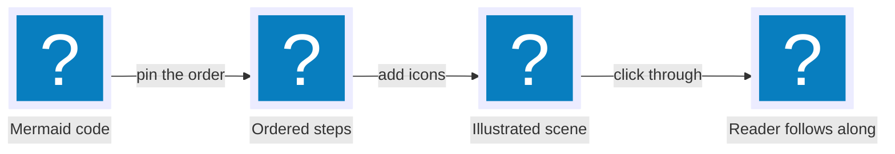
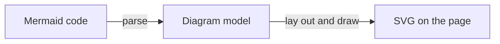
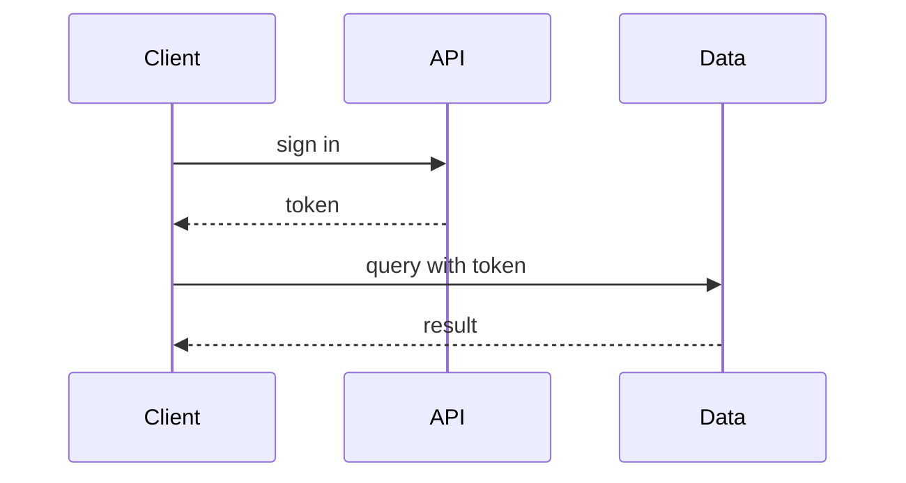

# pele-animate

[](https://www.npmjs.com/package/pele-animate)
[](https://github.com/dkdev24/pele-animate/actions/workflows/ci.yml)
[](LICENSE)

> **TL;DR** — pele-animate turns Mermaid diagrams into step-by-step animated scenes with icons. You write plain Mermaid,
> pin the reveal order with a `%% pa:` comment, and readers click through the steps (or watch them autoplay). Built as a
> post-processor on [Pele](https://github.com/obsidianmd/pele) (MIT): small (~20 KB core), synchronous rendering, MIT licensed.

Mermaid diagrams that explain themselves one step at a time, with icons. You choose the order things appear in, readers
step through it, and nodes can carry icons. A small post-processor for [Pele](https://github.com/obsidianmd/pele) (MIT),
which renders the Mermaid; this adds the step order, the playback and the icons. It is not a theme package.
Unofficial add-on; not affiliated with or endorsed by the Pele or Obsidian teams.

**[Website](https://pele-animate.danielkimdev.com/) · [Docs](docs/getting-started.md) · [npm](https://www.npmjs.com/package/pele-animate) · [Changelog](CHANGELOG.md)**


- **You set the order.** Nodes appear in the order of a `%% pa:` comment, or by default along the edges; edges draw in and labels fade in.
- **Readers step through it.** Click (or Enter) starts step mode: previous / play-pause / next buttons, Space, ←/→ and Esc. Hover or focus sends tokens along the edges.
- **Icons.** `@{ icon: "name" }` nodes use any of 4,368 [Tabler](https://github.com/tabler/tabler-icons) icons (loaded per category) or your own. Unknown names get a neutral rounded square.
- Flowcharts, sequence diagrams, architecture diagrams, state diagrams, C4 context, block, class and ER diagrams, timelines, journeys, git graphs and Gantt charts. The finished picture is the resting state; `prefers-reduced-motion` turns the motion off. Light and dark themes.
- The source stays valid Mermaid. One catch: GitHub's own Mermaid renderer does not know the icon names and draws "?" boxes, so the icon examples in this repository are shown as source text.

## Install

```sh
npm i pele-animate pele
# or
pnpm add pele-animate pele
yarn add pele-animate pele
bun add pele-animate pele
```

`pele` is a peer dependency (`^1.7.0`): install it alongside. Both packages run in the browser and need the DOM, so mount them on the client (see [recipes](docs/recipes.md)). ESM only.

## Use

```js
import { mount } from 'pele';
import { watch, prepare } from 'pele-animate';
import { icons } from 'pele-animate/glyphs';
import 'pele-animate/tabler/document'; // one Tabler icon category per import; add as many as you need
import 'pele-animate/tabler/text';
import 'pele-animate/tabler/design';
import 'pele-animate/tabler/media';
import 'pele-animate/style.css';

for (const el of document.querySelectorAll('pre.mermaid')) {
  const src = el.textContent;
  mount(el, prepare(src), { icons });
  watch(el, src); // re-applies after Pele re-lays-out on resize
}
```

Mermaid source:



`%% pa: 1=W 2=W>O 3=O>I 4=I>R` pins the order: each node, then the edge to the next (optional). `autoplay` skips the scroll intro and loops step mode once the diagram is on screen. `form: "square", h: 88` makes a large frameless icon.

## Documentation

Everything is in [`docs/`](docs/getting-started.md), and ships inside the npm package:

| | |
|---|---|
| [Getting started](docs/getting-started.md) · [How it works](docs/how-it-works.md) · [Diagram types](docs/diagram-types.md) | The basics |
| [Icons](docs/icons.md) · [Custom icons](docs/custom-icons.md) · [Step order](docs/step-order.md) · [Theming](docs/theming.md) · [Recipes](docs/recipes.md) | Guides (Vite, Astro, SvelteKit, Nuxt, React) |
| [API](docs/api.md) · [Compatibility](docs/compatibility.md) · [Accessibility](docs/accessibility.md) · [Security](docs/security.md) | Reference |
| [For coding agents](docs/agents.md) · [FAQ](docs/faq.md) · [Contributing](docs/contributing.md) | Everything else |

**Coding agents:** the package includes a skill, `skills/pele-animate/`, that wires the library into a project and checks the
result in a browser. See [For coding agents](docs/agents.md).

## Compare

Which renderer for which job:

| | Mermaid.js | Pele | pele-animate |
|---|---|---|---|
| Best for | Static diagrams anywhere, including GitHub and chat | Lightweight static SVG on a page | Guided walkthroughs: explain a diagram one step at a time |
| Layout | Fixed; scales down to fit, so text shrinks | Re-lays-out for the width it has | Pele's layout, plus your step order |
| Motion | None | None | Step playback, autoplay, hover tokens along edges |
| Icons | No | No | 4,368 Tabler icons (per-category imports) or your own |
| Footprint | Full Mermaid.js bundle | Small, synchronous | Pele + ~20 KB core (unminified) |
| License | MIT | MIT | MIT |

The same three-step flow, written left to right, in panels too narrow for it:



| Mermaid.js | Pele | pele-animate with autoplay | pele-animate with autoplay and icons |
|---|---|---|---|
|  |  |  |  |

Mermaid.js keeps a fixed layout and scales it down to fit, so the text shrinks. Pele lays the diagram out again for the width
it has. pele-animate adds the steps (the loops above run on their own; a click steps through them) and, optionally, icons.

The same Mermaid source, three renderers, for a sequence diagram. The pele-animate image loops: the intro draws in, then tokens
travel the edges (as on hover). Regenerate all images with `examples/capture.sh`.



| Renderer | Result |
|---|---|
| Mermaid |  |
| Pele |  |
| pele-animate |  |

## FAQ

**What is pele-animate?** A small JavaScript post-processor that turns Mermaid diagrams into step-by-step animated scenes
with icons. You write plain Mermaid; it adds step order, playback controls, and icons on top of Pele's rendering.

**How do I make a diagram play automatically?** Add `autoplay` to the `%% pa:` comment
(e.g. `%% pa: autoplay 1=A 2=A>B`). The intro draws in once the diagram is on screen, then step mode loops.

**Does it work with my framework?** Yes. It runs in the browser and mounts on the client; there are recipes for Vite,
Astro, SvelteKit, Nuxt, and React ([recipes](docs/recipes.md)).

**Is it free for commercial use?** Yes. pele-animate is MIT, Pele is MIT, and the Tabler icon packs are MIT
(see [THIRD-PARTY-NOTICES.md](THIRD-PARTY-NOTICES.md)).

Full list: [docs/faq.md](docs/faq.md).

## Credits and license

MIT. Built on [Pele](https://github.com/obsidianmd/pele) by kepano (MIT); this is an unofficial add-on, not affiliated with or
endorsed by the Pele or Obsidian teams. The Tabler icon packs come from [Tabler Icons](https://github.com/tabler/tabler-icons)
(MIT, Paweł Kuna); see [THIRD-PARTY-NOTICES.md](THIRD-PARTY-NOTICES.md). See also [CHANGELOG.md](CHANGELOG.md).
