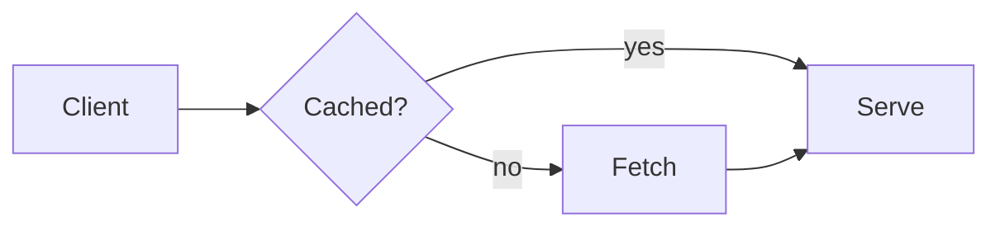
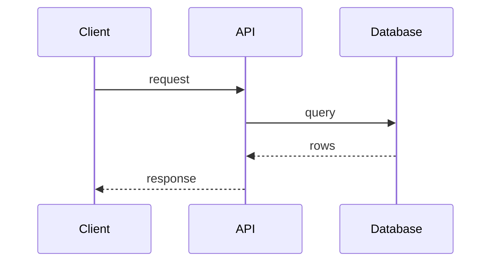

# Diagram types

pele-animate supports **flowcharts** and **sequence diagrams**. Pele renders other diagram types too, but they are outside what
pele-animate is built for.

## Flowcharts

Nodes appear in step order, edges draw from their source node, and edge labels fade in. Groups (`subgraph`) and their titles
are kept. Icon nodes (`@{ icon }`) work here; see [icons](./icons.md).

## Sequence diagrams

Actors appear first, then the messages in order. Participant boxes in a row get the same height, and group titles are bold.

**Limit:** Pele ignores `@{ icon }` on sequence participants (the box shows its id), so icons apply to flowcharts only.

## Everything else

Other Mermaid types (class, state, ER, gantt, pie and the rest) render through Pele as usual. pele-animate is not designed for
them and its behavior on them is untested, so use plain Pele for those. Step mode has been checked in a browser on
flowcharts only; sequence diagrams have not been checked the same way yet.
