# Diagram types

pele-animate animates these Mermaid diagram types. Each one plays an intro when it scrolls into view and, on click, steps through its
items with previous / play / next controls.

| Type | Each step reveals | Pins, icons | Remarks |
|---|---|---|---|
| [Flowchart](#flowcharts) `flowchart` | Nodes level by level, edges from their source | Pins and icons | The fullest support: groups, edge labels, large icon nodes. |
| [Sequence diagram](#sequence-diagrams) `sequenceDiagram` | Actors, then one message at a time | Neither | The order is the source order; reordering messages changes what the diagram says. |
| [Architecture](#architecture-diagrams) `architecture-beta` | Services level by level, edges from their source | Pins and icons | Icons are written `(name)` and are small and fixed in size. |
| [State diagram](#state-diagrams) `stateDiagram-v2` | States and transitions from the start marker | Pins | Markers are `root_start` and `root_end`. Composite states are untested. |
| [C4 context](#c4-context-diagrams) `C4Context` | People and systems, then relationships | Pins | Only `C4Context` is checked. Keep `Rel` labels short. |
| [Block diagram](#block-diagrams) `block-beta` | Blocks and arrows from their source | Pins | Put linked blocks in the same row or column. |
| [Class diagram](#class-diagrams) `classDiagram` | Classes and relationships, from the class written first | Pins | `A <\|-- B` reveals `A`, then `B`. |
| [ER diagram](#er-diagrams) `erDiagram` | Entities and relationships, from the entity written first | Pins | Same written-order rule as class diagrams. |
| [Timeline](#timelines-journeys-git-graphs-and-gantt-charts) `timeline` | One time period with its events | Neither | Section headers stay visible. |
| [User journey](#timelines-journeys-git-graphs-and-gantt-charts) `journey` | One task, its face and the line joining it to the last | Neither |  |
| [Git graph](#timelines-journeys-git-graphs-and-gantt-charts) `gitGraph` | One commit with its edge; a branch with its first commit | Neither | Cherry-picks and tags are untested. |
| [Gantt chart](#timelines-journeys-git-graphs-and-gantt-charts) `gantt` | One task, top to bottom | Neither | `todayMarker` and parallel tasks are untested. |

Pins are `%% pa:` comments; see [step order](./step-order.md). Types without pins use their source order. Icons are set up in
[icons](./icons.md). Pele renders the other Mermaid types too (pie, quadrant, radar and the rest), but pele-animate is not built
for them; see [Everything else](#everything-else).

## Flowcharts

Nodes appear in step order, edges draw from their source node, and edge labels fade in. Groups (`subgraph`) and their titles
are kept. Icon nodes (`@{ icon }`) work here; see [icons](./icons.md).

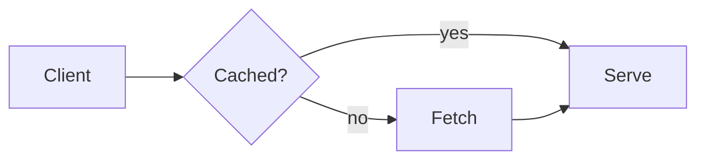

## Sequence diagrams

Actors appear first, then the messages in order. Participant boxes in a row get the same height, and group titles are bold.

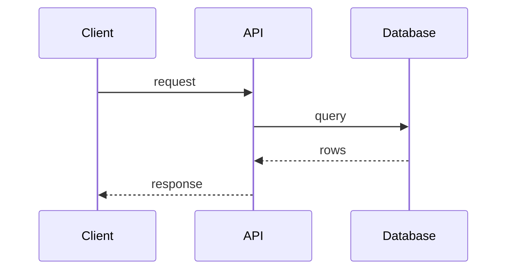

**Limit:** Pele ignores `@{ icon }` on sequence participants (the box shows its id), so icons apply to flowcharts only.

## Architecture diagrams

`architecture-beta`: services in groups, joined by edges. Services appear in step order like flowchart nodes, groups stay visible,
and `%% pa:` pins work the same way. The icon in parentheses is looked up in your icon packs, so Tabler names and `doverunner-*`
names work (import the packs as for [icons](./icons.md)).

```mermaid-icons live
architecture-beta
  group edge(cloud)[Edge]
  group core(cloud)[Core]
  service user(device-desktop)[User]
  service cdn(cloud-computing)[CDN] in edge
  service api(server)[API] in core
  service db(database)[Database] in core
  user:R --> L:cdn
  cdn:R --> L:api
  api:R --> L:db
```

Icons here are small and fixed in size; `form` and `h` apply to flowcharts only. Edges are read from their written direction
(`user:R --> L:cdn` is user to cdn). A node id containing `-` can be mistaken for two ids on an edge, so use plain ids.

## State diagrams

`stateDiagram-v2`: states appear in step order, transitions draw from their source state, and transition labels fade in. The
start and end markers are nodes too, with the ids `root_start` and `root_end`, so pins can name them.

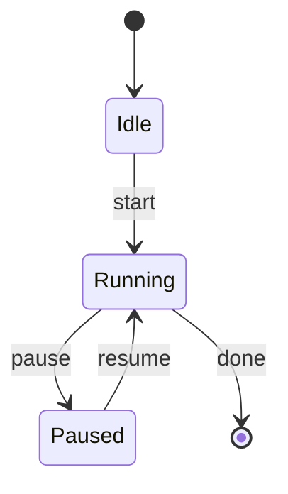

Without pins the order is breadth-first from the start marker, which shows `Paused` and the end marker together. Pele gives
state edges no readable ids, so pele-animate finds each transition's ends from where its path starts and stops. Composite
states and forks are untested. State diagrams take no icons.

## C4 context diagrams

`C4Context`: people and systems appear in step order and each `Rel` draws from its source, with its label. Pins use the ids you
give `Person(...)` and `System(...)`; an edge pin is `3=app>drm`.

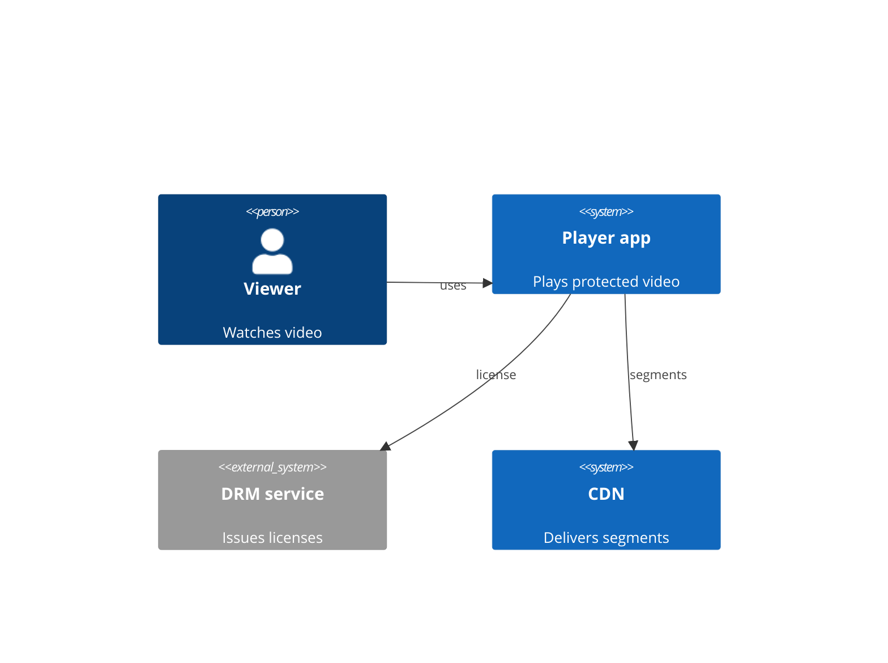

Pele lays C4 diagrams out in rows, so a long label between two boxes in the same row can leave no room for the arrowhead:
keep `Rel` labels short. Only `C4Context` has been checked; the other C4 types and boundaries are untested. C4 shapes take no icons.

## Block diagrams

`block-beta`: blocks appear in step order and each arrow draws from its source block. Pins use the block ids.

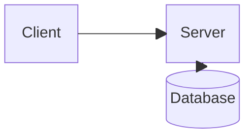

Pele routes arrows between blocks in straight lines or short bends, so place linked blocks in the same row or column; a diagonal
neighbour can give a bent arrow that runs along another one. Block diagrams take no icons.

## Class diagrams

`classDiagram`: classes appear in step order, relationships draw from the class written first. `Animal <|-- Dog` reveals `Animal`
and then `Dog`, whichever way the arrowhead points. Pins use the class names.

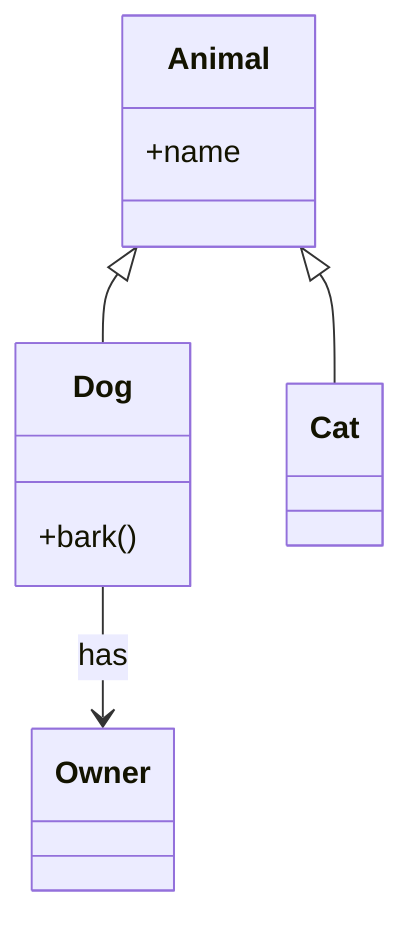

## ER diagrams

`erDiagram`: entities appear in step order, relationships draw from the entity written first (`CUSTOMER ||--o{ ORDER` reveals
`CUSTOMER`, then `ORDER`).

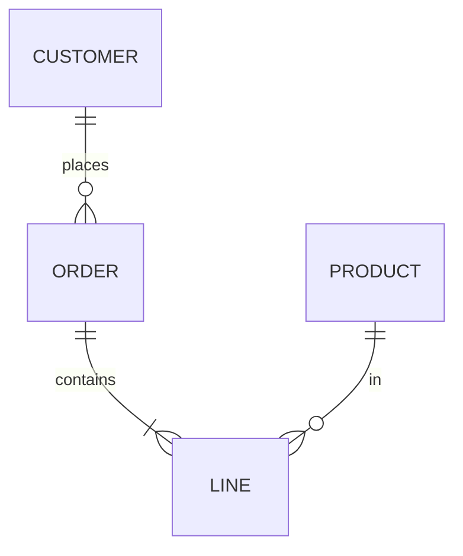

Neither takes icons.

## Timelines, journeys, git graphs and Gantt charts

These have no edges to follow, so each steps through its items in reading order and `%% pa:` pins do nothing (as for sequence
diagrams). Section headers, axes, grids and legends stay visible.

- **`timeline`:** one step per time period, with its events.

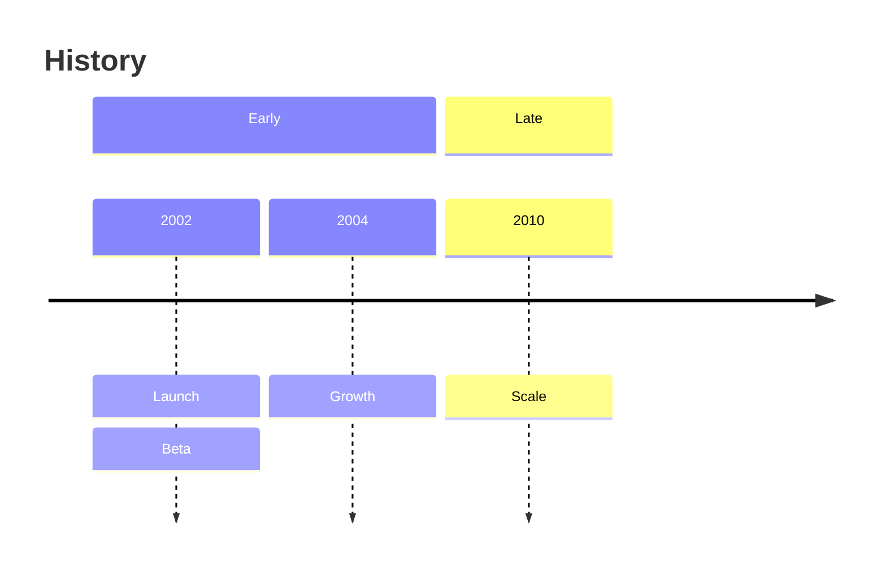

- **`journey`:** one step per task: the task, its face, and the line segment that joins it to the task before.

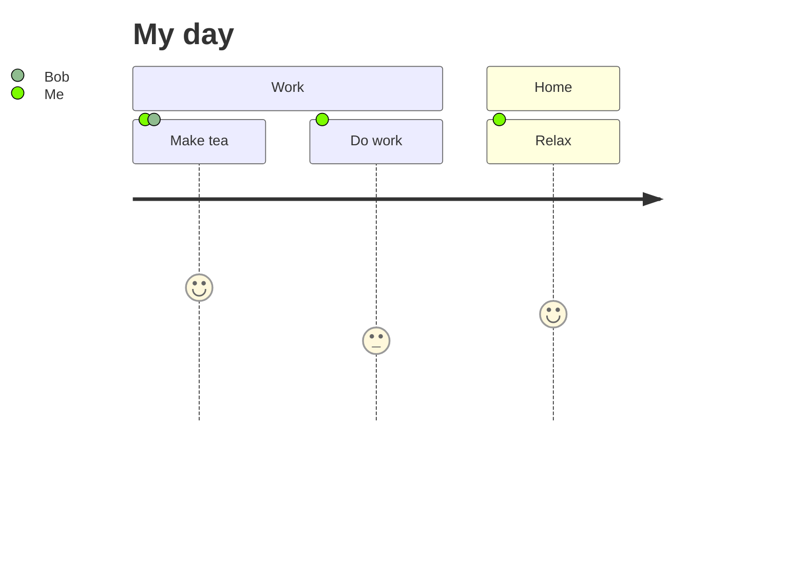

- **`gitGraph`:** one step per commit in the order written, with the edge that ends on it. A branch's label and lane appear with
  its first commit.

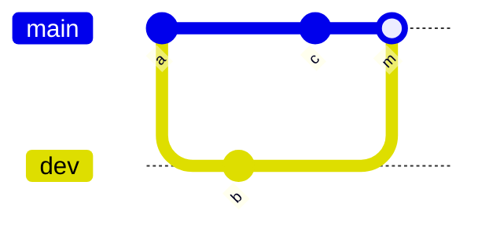

- **`gantt`:** one step per task, top to bottom.

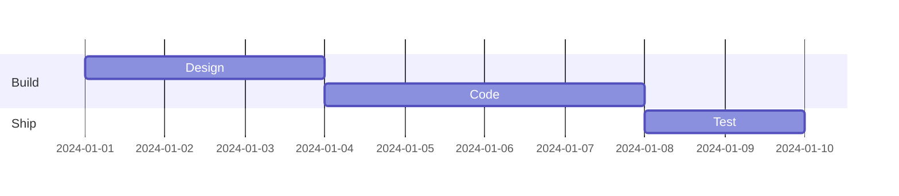

None of these take icons. Only these small examples have been checked in a browser; long diagrams, `todayMarker`, tags, cherry-picks and
parallel tasks are untested.

## Everything else

Other Mermaid types (pie, quadrant, radar and the rest) render through Pele as usual. pele-animate is not designed for
them and its behavior on them is untested, so use plain Pele for those. Step mode has been checked in a browser on
the types above only; sequence diagrams have not been checked the same way yet.
