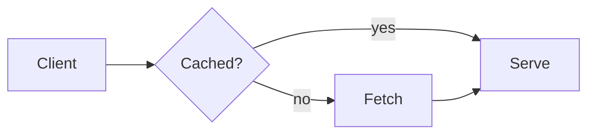
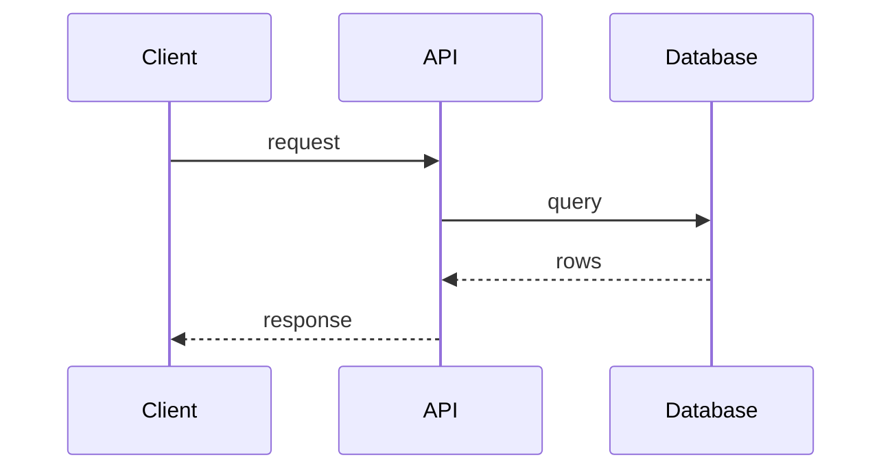
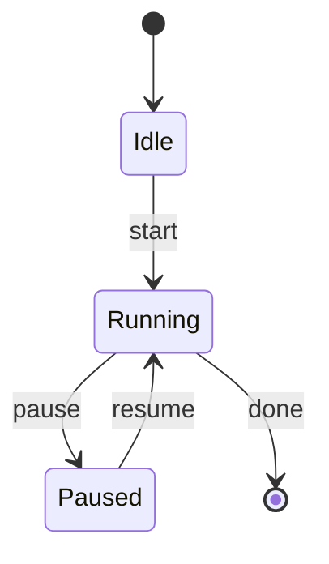
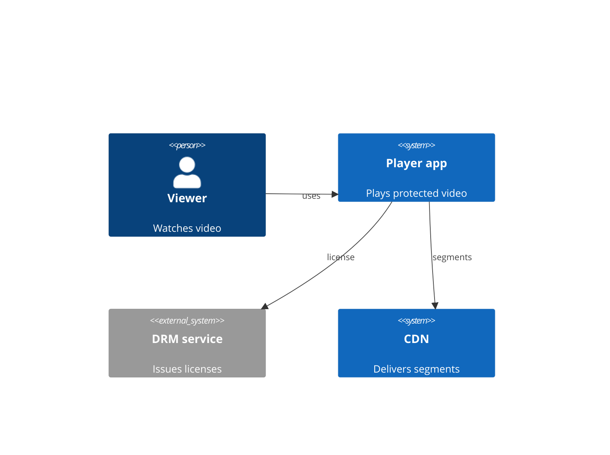
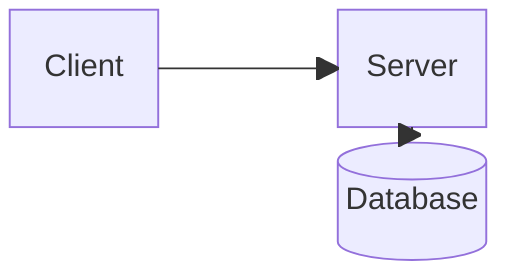

# Diagram types

pele-animate supports **flowcharts**, **sequence diagrams**, **architecture diagrams** and **state diagrams** and **C4 context diagrams** and **block diagrams**. Pele renders other diagram types too, but they are outside what
pele-animate is built for.

## Flowcharts

Nodes appear in step order, edges draw from their source node, and edge labels fade in. Groups (`subgraph`) and their titles
are kept. Icon nodes (`@{ icon }`) work here; see [icons](./icons.md).

## Sequence diagrams

Actors appear first, then the messages in order. Participant boxes in a row get the same height, and group titles are bold.

**Limit:** Pele ignores `@{ icon }` on sequence participants (the box shows its id), so icons apply to flowcharts only.

## Architecture diagrams

`architecture-beta`: services in groups, joined by edges. Services appear in step order like flowchart nodes, groups stay visible,
and `%% pa:` pins work the same way. The icon in parentheses is looked up in your icon packs, so Tabler names and `doverunner-*`
names work (import the packs as for [icons](./icons.md)).

```mermaid-icons live
architecture-beta
  group edge(cloud)[Edge]
  group core(cloud)[Core]
  service user(device-desktop)[User]
  service cdn(cloud-computing)[CDN] in edge
  service api(server)[API] in core
  service db(database)[Database] in core
  user:R --> L:cdn
  cdn:R --> L:api
  api:R --> L:db
```

Icons here are small and fixed in size; `form` and `h` apply to flowcharts only. Edges are read from their written direction
(`user:R --> L:cdn` is user to cdn). A node id containing `-` can be mistaken for two ids on an edge, so use plain ids.

## State diagrams

`stateDiagram-v2`: states appear in step order, transitions draw from their source state, and transition labels fade in. The
start and end markers are nodes too, with the ids `root_start` and `root_end`, so pins can name them.

Without pins the order is breadth-first from the start marker, which shows `Paused` and the end marker together. Pele gives
state edges no readable ids, so pele-animate finds each transition's ends from where its path starts and stops. Composite
states and forks are untested. State diagrams take no icons.

## C4 context diagrams

`C4Context`: people and systems appear in step order and each `Rel` draws from its source, with its label. Pins use the ids you
give `Person(...)` and `System(...)`; an edge pin is `3=app>drm`.

Pele lays C4 diagrams out in rows, so a long label between two boxes in the same row can leave no room for the arrowhead:
keep `Rel` labels short. Only `C4Context` has been checked; the other C4 types and boundaries are untested. C4 shapes take no icons.

## Block diagrams

`block-beta`: blocks appear in step order and each arrow draws from its source block. Pins use the block ids.

Pele routes arrows between blocks in straight lines or short bends, so place linked blocks in the same row or column; a diagonal
neighbour can give a bent arrow that runs along another one. Block diagrams take no icons.

## Everything else

Other Mermaid types (ER, class, gantt, pie and the rest) render through Pele as usual. pele-animate is not designed for
them and its behavior on them is untested, so use plain Pele for those. Step mode has been checked in a browser on
flowcharts, architecture, state, C4 context and block diagrams only; sequence diagrams have not been checked the same way yet.
