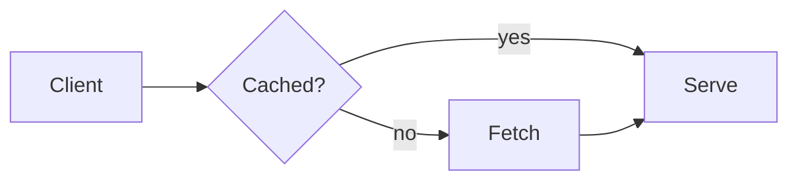
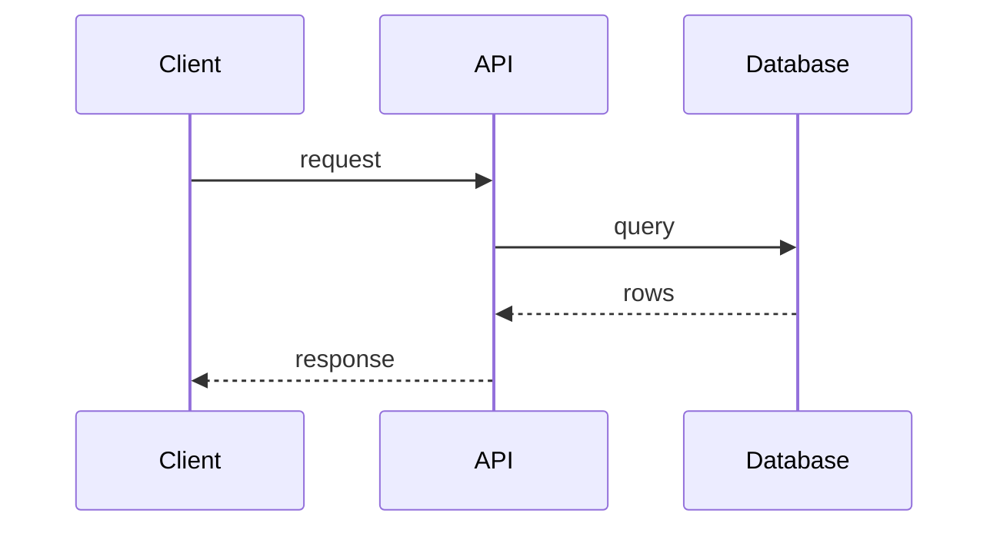
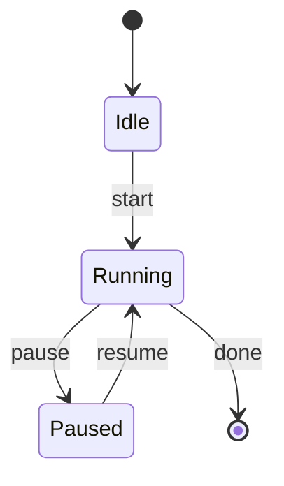

# Diagram types

pele-animate supports **flowcharts**, **sequence diagrams**, **architecture diagrams** and **state diagrams**. Pele renders other diagram types too, but they are outside what
pele-animate is built for.

## Flowcharts

Nodes appear in step order, edges draw from their source node, and edge labels fade in. Groups (`subgraph`) and their titles
are kept. Icon nodes (`@{ icon }`) work here; see [icons](./icons.md).

## Sequence diagrams

Actors appear first, then the messages in order. Participant boxes in a row get the same height, and group titles are bold.

**Limit:** Pele ignores `@{ icon }` on sequence participants (the box shows its id), so icons apply to flowcharts only.

## Architecture diagrams

`architecture-beta`: services in groups, joined by edges. Services appear in step order like flowchart nodes, groups stay visible,
and `%% pa:` pins work the same way. The icon in parentheses is looked up in your icon packs, so Tabler names and `doverunner-*`
names work (import the packs as for [icons](./icons.md)).

```mermaid-icons live
architecture-beta
  group edge(cloud)[Edge]
  group core(cloud)[Core]
  service user(device-desktop)[User]
  service cdn(cloud-computing)[CDN] in edge
  service api(server)[API] in core
  service db(database)[Database] in core
  user:R --> L:cdn
  cdn:R --> L:api
  api:R --> L:db
```

Icons here are small and fixed in size; `form` and `h` apply to flowcharts only. Edges are read from their written direction
(`user:R --> L:cdn` is user to cdn). A node id containing `-` can be mistaken for two ids on an edge, so use plain ids.

## State diagrams

`stateDiagram-v2`: states appear in step order, transitions draw from their source state, and transition labels fade in. The
start and end markers are nodes too, with the ids `root_start` and `root_end`, so pins can name them.

Without pins the order is breadth-first from the start marker, which shows `Paused` and the end marker together. Pele gives
state edges no readable ids, so pele-animate finds each transition's ends from where its path starts and stops. Composite
states and forks are untested. State diagrams take no icons.

## Everything else

Other Mermaid types (ER, class, gantt, pie and the rest) render through Pele as usual. pele-animate is not designed for
them and its behavior on them is untested, so use plain Pele for those. Step mode has been checked in a browser on
flowcharts, architecture and state diagrams only; sequence diagrams have not been checked the same way yet.
