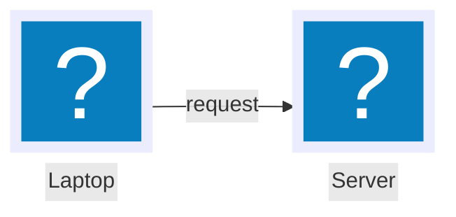

# Icons

A flowchart node becomes an illustrated node with Mermaid's own `@{ }` syntax:



Both names are in the Tabler `devices` category, so this needs `import 'pele-animate/tabler/devices'`.

- `icon` is the glyph name. `label` is the caption.
- `form: "square", h: 88` makes a large frameless icon. Leave both out for a small icon inside a frame.
- Call `mount(el, prepare(src), { icons })` with `prepare` from `pele-animate`. Pele sizes an icon node from its label, so a label shorter than `h` would put edge ends and arrowheads under the icon; `prepare` pads the label so the box fits.
- Unknown names get a neutral rounded square, never a blank slot. Pele ships no icons of its own, so every name must come
  from a pack you import.

## Packs

Icons come from packs. Importing a pack module registers its icons.

| Pack | Import | Contents |
|---|---|---|
| **Tabler categories** | `pele-animate/tabler/<category>` | 4,368 outline icons in 36 categories, from [Tabler Icons](https://github.com/tabler/tabler-icons) 3.49.0 (MIT) |
| **doverunner-\*** (optional) | `pele-animate/preset-doverunner` | 20 filled, two-tone illustrations named `doverunner-<name>` (see below) |
| **Your own** | `registerGlyphs()` | See [custom icons](./custom-icons.md) |

Pass the resolver to Pele: `mount(el, src, { icons })` with `import { icons } from 'pele-animate/glyphs'`.

### Tabler categories

Import only the categories you use; each is its own module (the largest, `system`, is about 199 KB).

| Category | Icons | Category | Icons | Category | Icons |
|---|---|---|---|---|---|
| system | 784 | map | 263 | food | 96 |
| devices | 363 | document | 209 | buildings | 95 |
| design | 350 | text | 194 | vehicles | 90 |
| arrows | 333 | shapes | 187 | math | 88 |
| media | 160 | e-commerce | 155 | health | 87 |
| communication | 121 | sport | 76 | currencies | 76 |
| development | 63 | weather | 61 | photography | 52 |
| mood | 52 | nature | 50 | games | 48 |
| computers | 44 | database | 42 | laundry | 40 |
| charts | 39 | symbols | 37 | badges | 22 |
| electrical | 19 | animals | 18 | gestures | 17 |
| version-control | 16 | extensions | 13 | logic | 8 |

Brand, Letters, Numbers, Zodiac and Gender are not included. Counts are for Tabler 3.49.0.

### Finding a name

Do not guess names. Look them up:

- The [icon browser](https://pele-animate.pages.dev/icons/) searches names and tags and copies a ready snippet; the same list is [icons.json](https://pele-animate.pages.dev/icons.json).
- Tabler's own site, [tabler.io/icons](https://tabler.io/icons), lists names and categories (use the outline style).
- In your project: `node_modules/pele-animate/tabler/<category>.js` lists every name in that category as an object key.
- Names that exist in more than one place are not a problem: Tabler names are plain (`server`, `lock`), `doverunner-*` names are prefixed.

## Stroke width

Tabler icons are line icons drawn to work at any stroke width. Set the CSS variable `--pa-stroke` on the container:

```css
.pa-scene { --pa-stroke: 1; }
```

The default is `1.5`. Tabler draws at 2. The `doverunner-*` glyphs have a fixed stroke width.

## The optional doverunner-* pack

`pele-animate/preset-doverunner` ships 20 filled, two-tone glyphs in the style of the DoveRunner Lab product cards, named
`doverunner-<name>`: `player`, `server`, `key`, `document`, `shield`, `phone`, `cloud`, `package`, `token`, `lock`,
`database`, `video`, `media`, `encoder`, `storage`, `plugin`, `variants`, `watermark`, `bits-a`, `bits-b`. Import it only
if you want that look; nothing else needs it.
