# 다이어그램 유형

pele-animate는 다음 Mermaid 다이어그램 유형에 애니메이션을 적용합니다. 모든 유형이 화면에 들어오면 인트로를 재생하고, 클릭하면 이전/재생/다음 컨트롤로 항목을 한 단계씩 보여 줍니다.

| 유형 | 단계마다 보여 주는 것 | 핀, 아이콘 | 비고 |
|---|---|---|---|
| [플로차트](#플로차트) `flowchart` | 레벨 순서의 노드, 출발 노드에서 그려지는 엣지 | 핀과 아이콘 | 가장 폭넓게 지원합니다. 그룹, 엣지 레이블, 큰 아이콘 노드를 쓸 수 있습니다. |
| [시퀀스 다이어그램](#시퀀스-다이어그램) `sequenceDiagram` | 액터, 이어서 메시지 하나씩 | 둘 다 없음 | 순서는 소스 순서이므로 메시지 순서를 바꾸면 다이어그램의 의미가 달라집니다. |
| [아키텍처](#아키텍처-다이어그램) `architecture-beta` | 레벨 순서의 서비스, 출발 서비스에서 그려지는 엣지 | 핀과 아이콘 | 아이콘은 `(name)`으로 적으며 작고 크기가 고정됩니다. |
| [상태 다이어그램](#상태-다이어그램) `stateDiagram-v2` | 시작 마커부터 상태와 전이 | 핀 | 마커는 `root_start`와 `root_end`입니다. 복합 상태는 검증하지 않았습니다. |
| [C4 컨텍스트](#c4-컨텍스트-다이어그램) `C4Context` | 사람과 시스템, 이어서 관계 | 핀 | `C4Context`만 확인했습니다. `Rel` 레이블은 짧게 쓰시기 바랍니다. |
| [블록 다이어그램](#블록-다이어그램) `block-beta` | 블록과 출발 블록에서 그려지는 화살표 | 핀 | 연결된 블록은 같은 행이나 열에 두시기 바랍니다. |
| [클래스 다이어그램](#클래스-다이어그램) `classDiagram` | 먼저 적은 클래스부터 클래스와 관계 | 핀 | `A <\|-- B`는 `A`, 이어서 `B`를 보여 줍니다. |
| [ER 다이어그램](#er-다이어그램) `erDiagram` | 먼저 적은 엔티티부터 엔티티와 관계 | 핀 | 클래스 다이어그램과 같이 적은 순서를 따릅니다. |
| [타임라인](#타임라인-저니-깃-그래프-간트-차트) `timeline` | 한 시기와 그 시기의 이벤트 | 둘 다 없음 | 섹션 제목은 계속 보입니다. |
| [사용자 저니](#타임라인-저니-깃-그래프-간트-차트) `journey` | 작업 하나, 표정, 앞 작업과 잇는 선 | 둘 다 없음 |  |
| [깃 그래프](#타임라인-저니-깃-그래프-간트-차트) `gitGraph` | 커밋 하나와 그 엣지, 브랜치는 첫 커밋과 함께 | 둘 다 없음 | 체리픽과 태그는 검증하지 않았습니다. |
| [간트 차트](#타임라인-저니-깃-그래프-간트-차트) `gantt` | 위에서 아래로 작업 하나씩 | 둘 다 없음 | `todayMarker`와 병렬 작업은 검증하지 않았습니다. |

핀은 `%% pa:` 주석이며, 자세한 내용은 [단계 순서](./step-order.md)를 참고하시기 바랍니다. 핀이 없는 유형은 소스 순서를 따릅니다. 아이콘 설정은 [아이콘](./icons.md)에서 다룹니다. Pele는 파이, 사분면, 레이더 같은 다른 Mermaid 유형도 렌더링하지만 pele-animate는 그 유형을 대상으로 만들지 않았습니다. 자세한 내용은 [그 밖의 유형](#그-밖의-유형)을 참고하시기 바랍니다.

## 플로차트

노드는 단계 순서대로 나타나고, 엣지는 출발 노드에서 그려지며, 엣지 레이블은 서서히 보입니다. 그룹(`subgraph`)과 그룹 제목은 그대로 유지됩니다. 아이콘 노드(`@{ icon }`)도 여기서 사용할 수 있으며, [아이콘](./icons.md)을 참고하시기 바랍니다.

아래 핀은 캐시 적중에 해당하는 "제공"을 "가져오기"보다 먼저 보여 주고, `Fetch`에서 `Serve`로 가는 엣지를 마지막 단계로 따로 그립니다. 핀이 없으면 `Serve`와 `Fetch`가 함께 나타납니다.

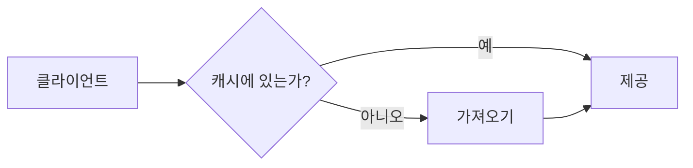

## 시퀀스 다이어그램

액터가 먼저 나타나고, 이어서 메시지마다 소스 순서대로 한 단계씩 진행되므로 캐시 미적중 흐름이 짧은 다섯 단계로 읽힙니다. 한 줄에 있는 참여자 박스는 높이가 같고, 그룹 제목은 굵게 표시됩니다.

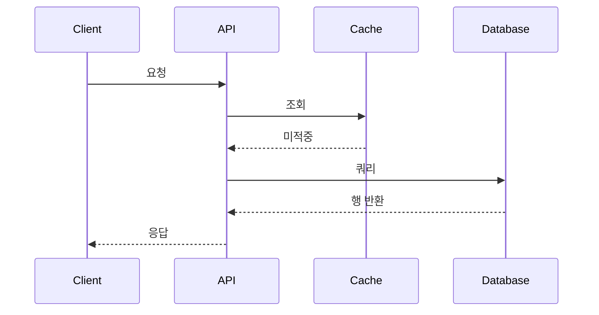

**제한 사항:** Pele는 시퀀스 참여자의 `@{ icon }`을 무시하고 박스에 id를 그대로 표시하므로, 아이콘은 플로차트에만 적용됩니다.

## 아키텍처 다이어그램

`architecture-beta`는 그룹 안의 서비스를 엣지로 잇는 다이어그램입니다. 서비스는 플로차트 노드처럼 단계 순서대로 나타나고, 그룹은 계속 보이며, `%% pa:` 핀도 같은 방식으로 동작합니다. 괄호 안의 아이콘은 가져온 아이콘 팩에서 찾으므로 Tabler 이름과 `doverunner-*` 이름을 모두 쓸 수 있습니다(팩은 [아이콘](./icons.md)에서처럼 import합니다). 아래 핀은 서비스를 먼저 보여 주고(요청 경로, 이어서 API 뒤에 있는 것들), 그다음 엣지 핀(`3=user>cdn`)으로 요청을 엣지 하나씩 따라갑니다.

여기의 아이콘은 작고 크기가 고정되어 있으며, `form`과 `h`는 플로차트에만 적용됩니다. 엣지는 적은 방향대로 읽습니다(`user:R --> L:cdn`은 user에서 cdn으로 가는 엣지입니다). 노드 id에 `-`가 들어 있으면 엣지에서 두 개의 id로 오인될 수 있으므로 단순한 id를 쓰시기 바랍니다.

## 상태 다이어그램

`stateDiagram-v2`는 상태가 단계 순서대로 나타나고, 전이는 출발 상태에서 그려지며, 전이 레이블은 서서히 보입니다. 시작 마커와 종료 마커도 노드이며 id가 `root_start`와 `root_end`이므로 핀에서 이름으로 지정할 수 있습니다.

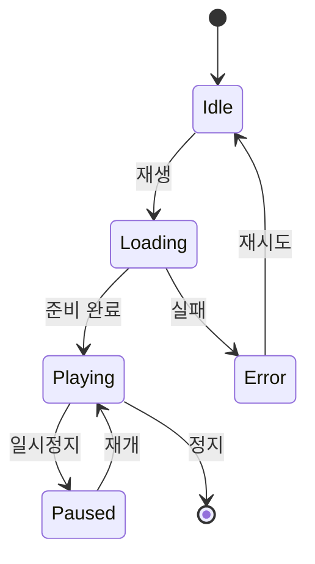

핀은 각 상태를 시청자가 만나는 순서대로 한 단계씩 보여 주며, `retry` 전이(`Error>Idle`)는 `Error`가 화면에 나온 뒤 별도 단계로 보여 줍니다. 핀이 없으면 시작 마커에서 너비 우선으로 진행되어 거리가 같은 상태가 함께 나타납니다(여기서는 `Playing`과 `Error`). Pele는 상태 엣지에 읽을 수 있는 id를 붙이지 않으므로, pele-animate는 경로가 시작하고 끝나는 위치를 보고 각 전이의 양 끝을 찾습니다. 복합 상태와 포크는 검증하지 않았으며, 상태 다이어그램에는 아이콘을 쓸 수 없습니다.

## C4 컨텍스트 다이어그램

`C4Context`는 사람과 시스템이 단계 순서대로 나타나고, 각 `Rel`이 출발점에서 레이블과 함께 그려집니다. 핀에는 `Person(...)`과 `System(...)`에 지정한 id를 쓰며, 엣지 핀은 `3=app>drm`처럼 적습니다. 아래 예시는 전체 구성을 먼저 보여 주고, 관계를 하나씩 그린 다음, 분석 시스템과 그 결과를 보는 운영자를 추가합니다.

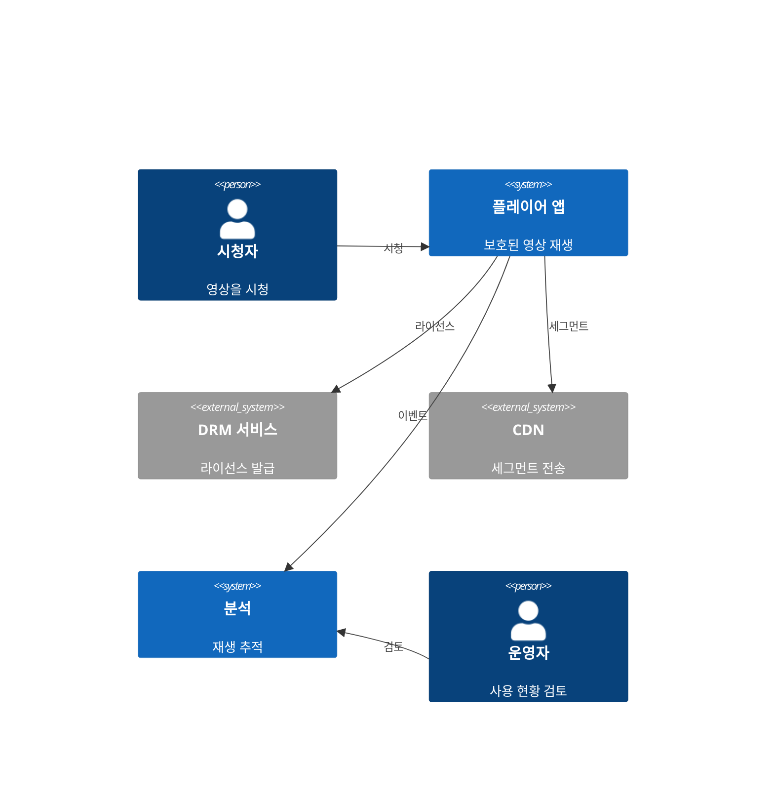

Pele는 C4 다이어그램을 행 단위로 배치하므로, 같은 행에 있는 두 박스 사이의 레이블이 길면 화살촉이 들어갈 공간이 없어질 수 있습니다. `Rel` 레이블은 짧게 쓰시기 바랍니다. `C4Context`만 확인했으며 다른 C4 유형과 경계는 검증하지 않았습니다. C4 도형에는 아이콘을 쓸 수 없습니다.

## 블록 다이어그램

`block-beta`는 블록이 단계 순서대로 나타나고, 각 화살표가 출발 블록에서 그려집니다. 핀에는 블록 id를 씁니다.

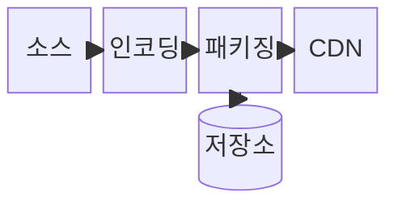

Pele는 블록 사이의 화살표를 직선이나 짧게 꺾은 선으로 연결하기 때문에, 연결된 블록은 같은 행이나 열에 두시기 바랍니다. 대각선 위치의 블록과 연결하면 다른 화살표를 따라 지나가는 꺾인 화살표가 생길 수 있습니다. 블록 다이어그램에는 아이콘을 쓸 수 없습니다.

## 클래스 다이어그램

`classDiagram`은 클래스가 단계 순서대로 나타나고, 관계는 먼저 적은 클래스에서 그려집니다. `Media <|-- Video`는 화살촉 방향과 관계없이 `Media`, 이어서 `Video`를 보여 줍니다. 핀에는 클래스 이름을 쓰며, 아래 예시는 기반 클래스, 하위 타입, 상속 화살표(별도 단계), 이를 사용하는 클래스 순으로 보여 줍니다. 엣지 핀은 양 끝을 어느 순서로 적어도 되므로, 소스는 `Media <|-- Video`여도 `Video>Media`로 화살표를 따라갈 수 있습니다.

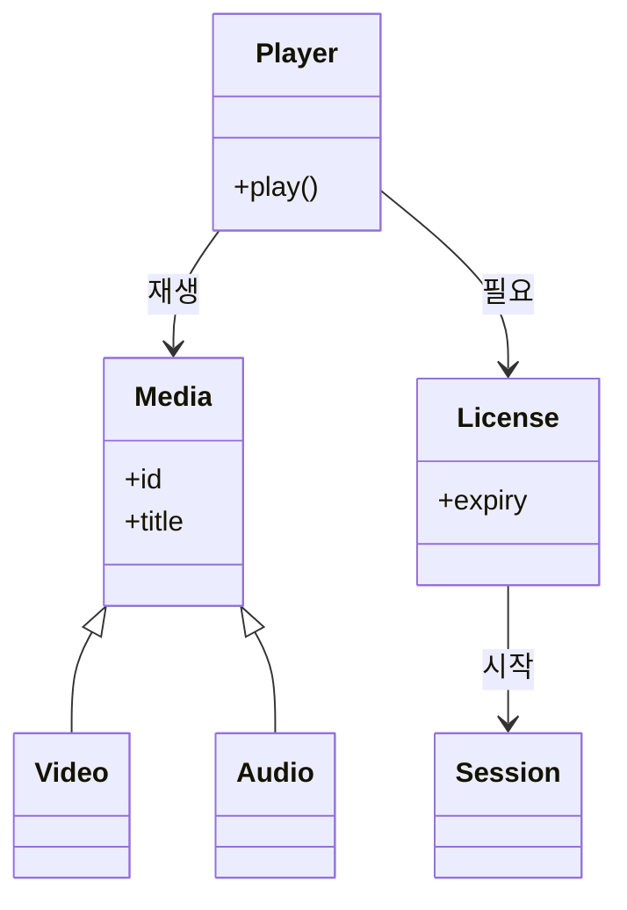

## ER 다이어그램

`erDiagram`은 엔티티가 단계 순서대로 나타나고, 관계는 먼저 적은 엔티티에서 그려집니다(`CUSTOMER ||--o{ ORDER`는 `CUSTOMER`, 이어서 `ORDER`를 보여 줍니다). 아래 예시는 고객에서 공급업체까지 순서대로 읽습니다.

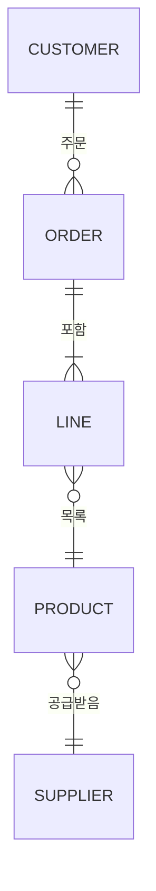

두 유형 모두 아이콘을 쓸 수 없습니다.

## 타임라인, 저니, 깃 그래프, 간트 차트

이 유형들은 따라갈 엣지가 없으므로 항목을 읽는 순서대로 한 단계씩 보여 주며, `%% pa:` 핀은 시퀀스 다이어그램처럼 적용되지 않습니다. 섹션 제목, 축, 격자, 범례는 계속 보입니다.

- **`timeline`:** 시기마다 한 단계씩 진행되며 해당 시기의 이벤트가 함께 나타납니다. 시기는 시간 순서대로 적으시기 바랍니다.

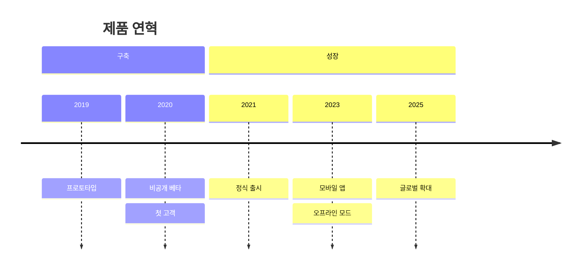

- **`journey`:** 작업마다 한 단계씩 진행되며, 작업, 표정, 앞 작업과 잇는 선분이 함께 나타납니다.

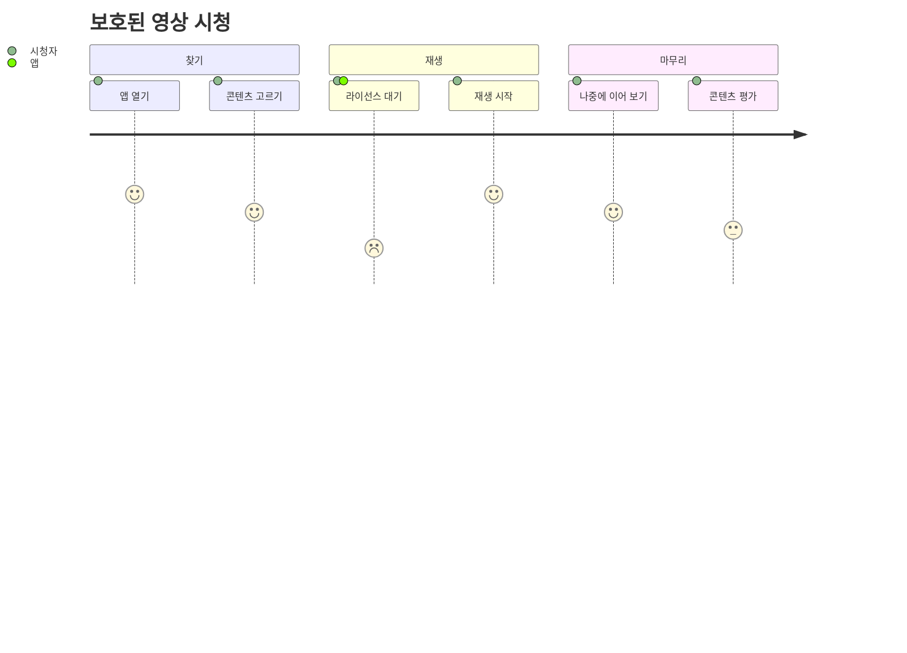

- **`gitGraph`:** 적은 순서대로 커밋마다 한 단계씩 진행되며, 그 커밋에서 끝나는 엣지가 함께 나타납니다. 브랜치의 레이블과 레인은 첫 커밋과 함께 나타납니다.

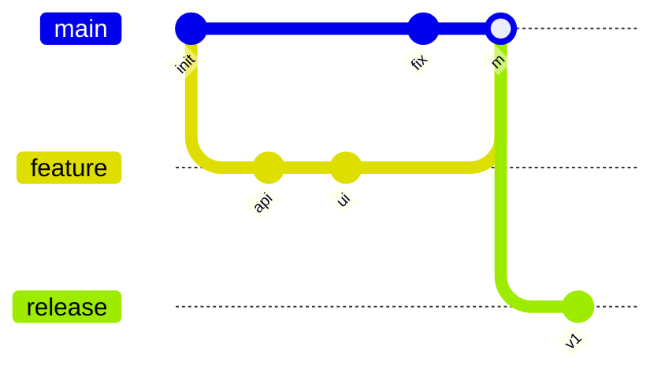

- **`gantt`:** 위에서 아래로 작업마다 한 단계씩 진행되므로, 나타나길 원하는 순서대로 작업을 적으시기 바랍니다.

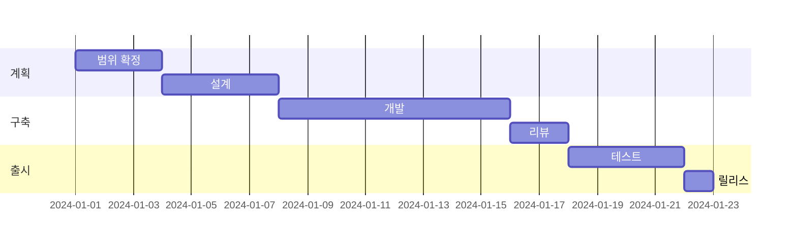

이 유형들은 모두 아이콘을 쓸 수 없습니다. 브라우저에서는 위의 작은 예시만 확인했으며, 긴 다이어그램, `todayMarker`, 태그, 체리픽, 병렬 작업은 검증하지 않았습니다.

## 그 밖의 유형

파이, 사분면, 레이더 같은 다른 Mermaid 유형은 Pele를 통해 평소처럼 렌더링됩니다. pele-animate는 이 유형을 대상으로 설계하지 않았고 동작도 검증하지 않았으므로, 이런 유형에는 Pele만 사용하시기 바랍니다. 단계 모드는 위에 나온 유형에서만 브라우저로 확인했으며, 시퀀스 다이어그램은 아직 같은 방식으로 확인하지 못했습니다.
