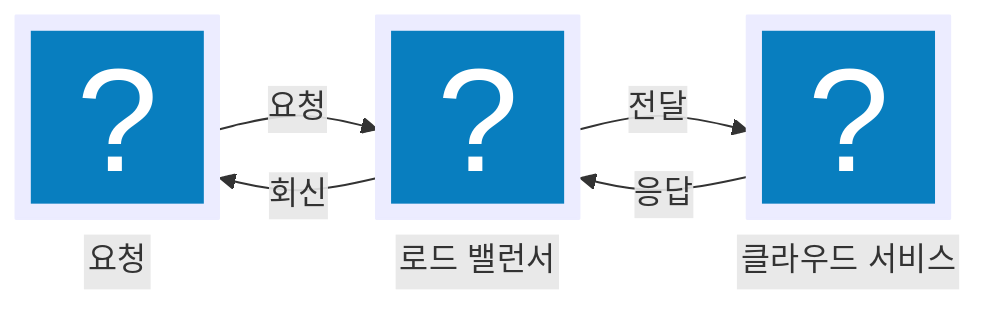

# 시작하기

pele-animate는 [Pele](https://pele.run)로 그린 다이어그램이 스스로 설명하도록 한 단계씩 보여 줍니다. 작성자가 나타나는 순서를 정하면 독자는 버튼이나 키보드로 그 순서를 따라가며, 어떤 노드에든 풍부한 아이콘 세트의 아이콘을 넣을 수 있습니다. Pele의 비공식 애드온이므로 Pele가 다이어그램을 배치하고 그리는 방식은 바꾸지 않습니다.

## 설치

```sh
npm i pele-animate pele
# 또는
pnpm add pele-animate pele
yarn add pele-animate pele
bun add pele-animate pele
```

`pele`는 피어 의존성(`^1.7.0`)이므로 함께 설치해야 합니다. 두 패키지 모두 브라우저에서 실행되고 DOM이 필요하기 때문에 클라이언트에서 마운트해야 하며, 프레임워크별 방법은 [레시피](./recipes.md)를 참고하시기 바랍니다. 패키지는 ESM만 지원합니다.

## 첫 다이어그램

Mermaid 소스를 요소에 넣고, Pele로 마운트한 다음 `watch()`에 넘깁니다.

```js
import { mount } from 'pele';
import { watch, prepare } from 'pele-animate';
import { icons } from 'pele-animate/glyphs';
import 'pele-animate/tabler/computers'; // 아이콘: Tabler 카테고리 하나이며, 필요한 만큼 import합니다
import 'pele-animate/style.css';

const el = document.querySelector('pre.mermaid');
const src = el.textContent;
mount(el, prepare(src), { icons }); // Pele가 SVG를 그립니다
watch(el, src);            // pele-animate가 애니메이션을 적용하고, 크기 변경으로 Pele가 다시 배치하면 다시 적용합니다
```

Mermaid 소스는 다음과 같습니다.



실행하면 다음과 같이 동작합니다.

- 다이어그램이 화면에 들어오면 인트로가 한 번 재생됩니다. 노드가 순서대로 나타나고, 엣지가 그려지며, 레이블이 서서히 보입니다.
- 마우스를 올리거나 포커스를 맞추면 작은 토큰이 엣지를 따라 움직입니다.
- 클릭하거나 포커스를 맞춘 뒤 Enter를 누르면 **단계 모드**가 됩니다. 이전, 재생/일시정지, 다음 버튼이 나타나며 Space, ←, →, Esc 키도 사용할 수 있습니다.
- `prefers-reduced-motion`이 설정되어 있으면 움직임이 꺼지고 완성된 그림만 보입니다.

`%% pa: 1=C 2=C>L 3=L>S 4=S>L 5=L>C` 주석은 순서를 고정합니다. 요청이 먼저 나오고, 이어서 왕복 경로의 각 구간이 차례로 나옵니다. 주석이 없으면 엣지 순서를 따릅니다. 자세한 내용은 [단계 순서](./step-order.md)에서 다룹니다.

## 다음 단계

- 아이콘 고르기: [아이콘](./icons.md)
- 순서 정하기: [단계 순서](./step-order.md)
- 사이트 색상에 맞추기: [테마](./theming.md)
