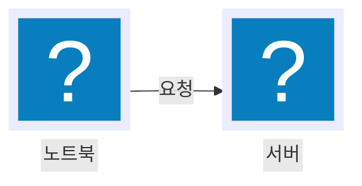

# 아이콘

Mermaid 고유의 `@{ }` 문법을 쓰면 플로차트 노드가 아이콘이 있는 노드로 바뀝니다.



두 이름 모두 Tabler의 `devices` 카테고리에 있으므로 `import 'pele-animate/tabler/devices'`가 필요합니다.

- `icon`은 글리프 이름이고 `label`은 캡션입니다.
- `form: "square", h: 88`을 지정하면 프레임이 없는 큰 아이콘이 되며, 둘 다 생략하면 프레임 안에 작은 아이콘이 들어갑니다.
- `mount(el, prepare(src), { icons })`처럼 `pele-animate`의 `prepare`를 거쳐서 Pele에 넘깁니다. Pele는 레이블을 기준으로 아이콘 노드의 크기를 정하기 때문에, 레이블이 `h`보다 짧으면 엣지 끝과 화살촉이 아이콘 밑에 들어가 버립니다. `prepare`는 박스가 맞도록 레이블에 여백을 채워 줍니다.
- 알 수 없는 이름은 빈 칸 대신 무난한 둥근 사각형으로 표시됩니다. Pele는 아이콘을 자체적으로 포함하지 않으므로, 모든 이름은 import한 팩에서 가져와야 합니다.

## 팩

아이콘은 팩으로 제공되며, 팩 모듈을 import하면 그 안의 아이콘이 등록됩니다.

| 팩 | import | 내용 |
|---|---|---|
| **Tabler 카테고리** | `pele-animate/tabler/<category>` | [Tabler Icons](https://github.com/tabler/tabler-icons) 3.49.0(MIT)의 아웃라인 아이콘 4,368개, 36개 카테고리 |
| **doverunner-\*** (선택) | `pele-animate/preset-doverunner` | `doverunner-<name>`으로 이름 붙인 채움형 투톤 일러스트 20개 (아래 참고) |
| **직접 만든 팩** | `registerGlyphs()` | [사용자 아이콘](./custom-icons.md)을 참고하시기 바랍니다 |

리졸버는 `import { icons } from 'pele-animate/glyphs'`로 가져와 `mount(el, src, { icons })`처럼 Pele에 전달합니다.

### Tabler 카테고리

카테고리마다 별도 모듈이므로 사용하는 카테고리만 import하시기 바랍니다. 가장 큰 `system`은 약 199 KB입니다.

| 카테고리 | 아이콘 수 | 카테고리 | 아이콘 수 | 카테고리 | 아이콘 수 |
|---|---|---|---|---|---|
| system | 784 | map | 263 | food | 96 |
| devices | 363 | document | 209 | buildings | 95 |
| design | 350 | text | 194 | vehicles | 90 |
| arrows | 333 | shapes | 187 | math | 88 |
| media | 160 | e-commerce | 155 | health | 87 |
| communication | 121 | sport | 76 | currencies | 76 |
| development | 63 | weather | 61 | photography | 52 |
| mood | 52 | nature | 50 | games | 48 |
| computers | 44 | database | 42 | laundry | 40 |
| charts | 39 | symbols | 37 | badges | 22 |
| electrical | 19 | animals | 18 | gestures | 17 |
| version-control | 16 | extensions | 13 | logic | 8 |

Brand, Letters, Numbers, Zodiac, Gender는 포함되지 않습니다. 개수는 Tabler 3.49.0 기준입니다.

### 이름 찾기

이름은 추측하지 말고 직접 찾아보시기 바랍니다.

- [아이콘 브라우저](https://pele-animate.danielkimdev.com/ko/icons/)에서 이름과 태그로 검색하고 바로 쓸 수 있는 코드를 복사할 수 있으며, 같은 목록이 [icons.json](https://pele-animate.danielkimdev.com/icons.json)으로도 제공됩니다.
- Tabler 공식 사이트 [tabler.io/icons](https://tabler.io/icons)에도 이름과 카테고리가 나와 있습니다(outline 스타일을 선택합니다).
- 프로젝트 안에서는 `node_modules/pele-animate/tabler/<category>.js`를 열면 해당 카테고리의 모든 이름이 객체 키로 나열되어 있습니다.
- 이름이 겹칠 걱정은 없습니다. Tabler 이름은 `server`, `lock`처럼 접두사가 없고, `doverunner-*` 이름에는 접두사가 붙기 때문입니다.

## 선 두께

Tabler 아이콘은 어떤 선 두께에서도 자연스럽게 보이도록 그려진 선형 아이콘입니다. 컨테이너에 CSS 변수 `--pa-stroke`를 지정하면 두께가 바뀝니다.

```css
.pa-scene { --pa-stroke: 1; }
```

기본값은 `1.5`이며, Tabler 원본은 2로 그려져 있습니다. `doverunner-*` 글리프의 선 두께는 고정되어 있습니다.

## 선택 팩: doverunner-*

`pele-animate/preset-doverunner`에는 DoveRunner Lab 제품 카드 스타일의 채움형 투톤 글리프 20개가 `doverunner-<name>`이라는 이름으로 들어 있습니다. 이름은 `player`, `server`, `key`, `document`, `shield`, `phone`, `cloud`, `package`, `token`, `lock`, `database`, `video`, `media`, `encoder`, `storage`, `plugin`, `variants`, `watermark`, `bits-a`, `bits-b`입니다. 이 스타일이 필요할 때만 import하시면 되며, 다른 기능은 이 팩에 의존하지 않습니다.
