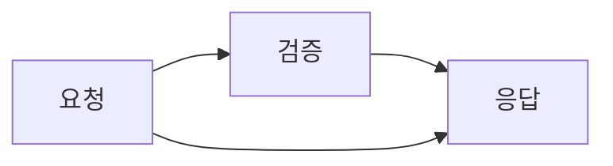
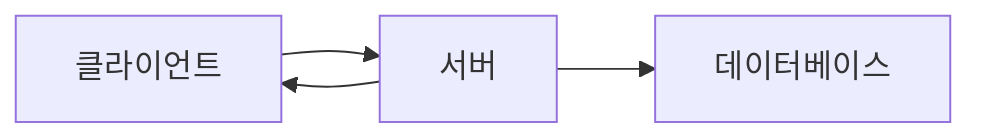

# 단계 순서

모든 다이어그램은 **단계**의 목록입니다. 인트로는 단계를 차례로 재생하고, 단계 모드에서는 독자가 단계를 직접 넘겨 봅니다. 기본 순서는 엣지를 따르며, `%% pa:` 주석으로 직접 정할 수도 있습니다.

## 기본 순서

- **플로차트:** 아무 노드도 가리키지 않는 노드부터 레벨 순으로 노드가 나타납니다. 각 엣지는 출발 노드가 화면에 나온 뒤에 그려지고, 도착 노드는 엣지가 닿을 때 나타납니다. 분기된 결정의 갈래는 함께 나타납니다.
- **아키텍처 다이어그램:** 플로차트와 같습니다. 서비스가 레벨 순으로 나타나고, 엣지는 작성한 방향을 따르며, 핀도 같은 방식으로 동작합니다.
- **타임라인, 저니, 깃 그래프, 간트 차트:** 읽는 순서(기간, 작업, 커밋, 작업)대로 항목마다 한 단계씩 진행되며, 핀은 적용되지 않습니다.
- **클래스 다이어그램과 ER 다이어그램:** 플로차트와 같지만, 관계는 먼저 적은 클래스 또는 엔티티에서 출발합니다.
- **블록 다이어그램:** 아무 블록도 가리키지 않는 블록부터 시작하는 플로차트와 같습니다.
- **C4 컨텍스트 다이어그램:** 아무도 가리키지 않는 사람과 시스템부터 시작하는 플로차트와 같습니다.
- **상태 다이어그램:** 시작 마커(`root_start`)에서 출발하는 플로차트와 같으며, 종료 마커는 `root_end`입니다.
- **시퀀스 다이어그램:** 액터가 먼저 나오고, 이어서 메시지가 순서대로 나옵니다.

## 핀

소스의 아무 곳에나 주석을 한 줄 추가합니다.



`%% pa: 1=A 2=B,C`는 1단계에서 A를, 2단계에서 B와 C를 보여 준다는 뜻입니다. 단계는 1부터 시작하며, 고정하지 않은 항목은 기본 레벨을 그대로 유지합니다.

### 엣지 핀

`X>Y`는 X에서 Y로 가는 엣지를 독립된 단계로 고정합니다. 이미 화면에 있는 두 노드 사이의 엣지도 하나의 단계로 만들 수 있습니다.



예상과 다르게 동작하지 않도록 다음 규칙을 지켜 주시기 바랍니다.

- **노드를 먼저 고정합니다.** 도착 노드보다 앞서 고정한 엣지는 일찍 닿습니다.
- 엣지 핀은 플로차트뿐 아니라 엣지가 있는 모든 다이어그램 유형에서 동작합니다.
- 양방향 엣지(`A <--> B`)는 먼저 적은 방향(`A>B`)으로 고정됩니다.
- 양 끝은 어느 순서로 적어도 됩니다(`Video>Media` 또는 `Media>Video`). 다만 다이어그램에 반대 방향 엣지도 있으면 적은 순서로 둘 중 어느 쪽인지 정해집니다.
- 핀은 id로 일치시키므로, 핀을 지정한 뒤에는 노드 id를 바꾸지 않아야 합니다.
- 번역한 페이지도 id가 같으면 되므로, id가 일치하는지 확인한 뒤 `%% pa:` 줄을 그대로 복사해서 쓰시면 됩니다.

## 단계 모드

다이어그램을 클릭하거나 포커스를 맞춘 뒤 Enter 또는 Space를 누르면 이전, 재생/일시정지, 다음 버튼이 있는 작은 바가 나타납니다.

| 키 | 동작 |
|---|---|
| Space | 재생 또는 일시정지 (재생은 일시정지하거나 다른 컨트롤을 누를 때까지 반복됩니다) |
| → | 다음 단계 |
| ← | 이전 단계 |
| Esc | 단계 모드 종료 |

Pele의 확대/축소 컨트롤(+/- 버튼과 키)은 단계 모드에서 숨겨집니다. 확대/축소와 단계 키가 모두 방향키와 Esc를 사용하기 때문에 두 기능을 함께 쓸 수 없습니다. 단계 모드에 들어가면 확대 상태가 초기화되고, 나오면 컨트롤이 다시 나타납니다.

### 저절로 재생하기

처음 한 번 재생되는 스크롤 인트로를 건너뛰고, 다이어그램이 화면에 보이는 즉시 단계를 반복 재생하려면 핀 주석에 `autoplay`를 추가합니다(`%% pa: autoplay 1=A 2=B`이며, `%% pa: autoplay`만 써도 됩니다). `watch(container, source, { autoplay: true })`처럼 옵션으로 넘겨도 됩니다. 재생 속도는 `interval`(단계 사이의 간격, ms, 기본값 1200)과 `hold`(마지막 단계를 보여 준 뒤 반복을 다시 시작하기까지의 시간, ms, 기본값 2400)로 조절하며, `{ interval: 800, hold: 3000 }`처럼 지정합니다. 이 값은 재생 버튼에도 적용됩니다. 일시정지하거나, 단계를 넘기거나, 단계 모드를 나가면 반복이 멈춥니다. 모션 줄이기 설정이 켜져 있으면 autoplay는 무시되고 완성된 다이어그램이 정지한 상태로 유지됩니다.

## 순서 확인하기

`animate()`가 실행된 뒤 `svg.paSteps`에는 단계마다 하나씩 배열이 담깁니다. 각 단계가 무엇을 보여 주는지 출력해 보면 순서를 확인할 수 있습니다.

```js
const svg = document.querySelector('.pa-scene svg.pele');
svg.paSteps.map((items, n) => `${n + 1}: ` + items.map(([el]) => el.textContent.trim() || el.dataset.id).join(' ; '));
```

브라우저 없이 확인하고 싶다면 `parseOrder(source)`가 파싱된 핀을 `Map`(노드 id 또는 `'X>Y'`에서 0부터 시작하는 단계 번호로)으로 돌려줍니다.
