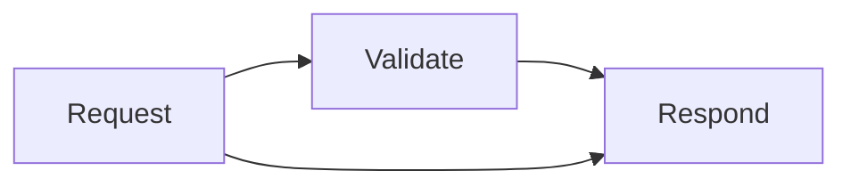
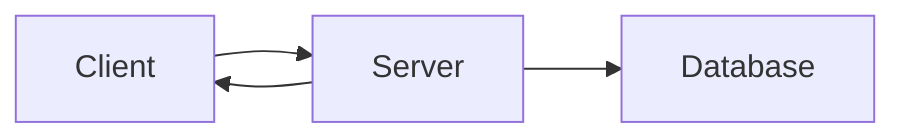

# Step order

Every diagram is a list of **steps**. The intro plays them one after another, and step mode lets the reader move through
them. By default, the order follows the edges. A `%% pa:` comment lets you set it yourself.

## Default order

- **Flowchart:** nodes appear by level, counting from the nodes nothing points to. Each edge draws from its source once the source
  is on screen, and its target appears as the edge lands. Branches of a decision appear together.
- **Architecture diagram:** like a flowchart: services appear by level, edges follow their written direction, pins work the same way.
- **Timeline, journey, git graph, Gantt chart:** one step per item in reading order (period, task, commit, task); pins do nothing.
- **Class and ER diagrams:** like a flowchart, but a relationship runs from the class or entity written first.
- **Block diagram:** like a flowchart, from the blocks nothing points to.
- **C4 context diagram:** like a flowchart, from the people and systems nothing points to.
- **State diagram:** like a flowchart, starting from the start marker (`root_start`); the end marker is `root_end`.
- **Sequence diagram:** actors first, then the messages in order.

## Pins

Add one comment line anywhere in the source:



`%% pa: 1=A 2=B,C` means: step 1 shows A, step 2 shows B and C. Steps are numbered from 1. Anything you do not pin keeps its default
level.

### Edge pins

`X>Y` pins the edge from X to Y to its own step, so an edge between two nodes that are already visible can be a step:



Rules that avoid surprises:

- **Pin the nodes first.** An edge pinned before its target appears lands early.
- Edge pins work in every diagram type that has edges, not only flowcharts.
- A two-way edge (`A <--> B`) is pinned in the direction you wrote it first (`A>B`).
- The ends may be named in either order (`Video>Media` or `Media>Video`), unless the diagram also has the opposite edge: then the order picks which of the two is meant.
- Do not rename node ids after pinning: pins match ids.
- Translated pages keep the same ids, so copy the `%% pa:` line across languages after checking the ids match.

## Step mode

Click the diagram, or focus it and press Enter or Space. A small bar appears with previous, play/pause and next.

| Key | Action |
|---|---|
| Space | Play or pause |
| → | Next step |
| ← | Previous step |
| Esc | Leave step mode |

## Checking your order

After `animate()` runs, `svg.paSteps` is one array per step. Print what each step shows:

```js
const svg = document.querySelector('.pa-scene svg.pele');
svg.paSteps.map((items, n) => `${n + 1}: ` + items.map(([el]) => el.textContent.trim() || el.dataset.id).join(' ; '));
```

`parseOrder(source)` returns the parsed pins as a `Map` (node id or `'X>Y'` to a 0-based step), if you want to check them
without a browser.
