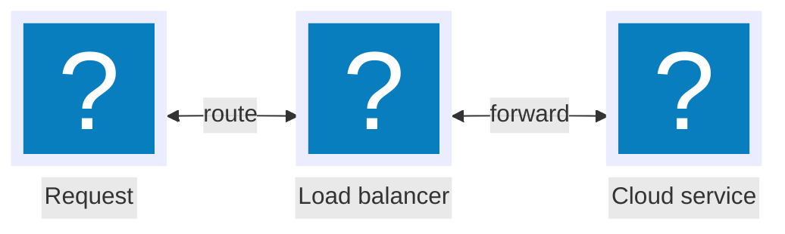

# pele-animate

pele-animate makes a [Pele](https://pele.run) diagram explain itself one step at a time: you choose the order things appear in,
readers step through it, and flowchart nodes can carry icons. It supports **flowcharts and sequence diagrams only**. Pele
does the layout; pele-animate is an unofficial add-on and not a theme package.

Your job when this skill is loaded: wire it into the project **and prove it renders**. Do not hand work back unverified.

## Hard rules

1. **Client only.** `pele` and `pele-animate` need the DOM. Load them with dynamic `import()` in the framework's mounted hook,
   never in server code.
2. **Never invent icon names.** Unknown names do not fail: they render a plain rounded square. Look names up (see Icons) and
   import the category that holds them.
3. **Import three things:** the resolver `icons` from `pele-animate/glyphs`, each icon category you use, and `pele-animate/style.css`.
4. **Do not rename node ids after pinning the order**: pins match ids.
5. **Verify in a browser** (last section). Reading the code is not a check.

## 1. Install

```sh
npm i pele-animate pele        # or pnpm / yarn / bun; pele is a peer dependency (^1.7.0)
```

## 2. Mount (client side)

```js
const [{ mount }, { watch }, { icons }] = await Promise.all([
  import('pele'), import('pele-animate'), import('pele-animate/glyphs'),
  import('pele-animate/tabler/computers'),   // one import per icon category you use
  import('pele-animate/style.css'),
]);
mount(el, src, { icons });   // Pele draws the SVG from the Mermaid text in `src`
watch(el, src);              // pele-animate animates it (also on resize)
```

`el` is an element that holds the Mermaid source: a `<pre>` whose text is the diagram, or any element you set first with
`el.textContent = src`. Mount once per element. `await` at the top level works in current Vite builds; elsewhere wrap the code
in an `async` function.
Framework placement (Vite, Astro, SvelteKit, Nuxt, React): `docs/recipes.md` in the package, or the table below.

| Framework | Put it in |
|---|---|
| Plain HTML / Vite | A module script |
| Astro | A client `<script>` that finds the diagram elements |
| SvelteKit | `onMount(async () => { ... })` |
| Nuxt | `onMounted` in a `.client.vue` component |
| React / Next.js (untested) | A client component, `useEffect` |

TypeScript: a CSS side-effect import needs a `*.css` module declaration unless the project uses Vite's client types.

## 3. Write the diagram

Icon nodes use Mermaid's own syntax:



- `form: "square", h: 88` = large frameless icon. Leave both out for a small icon in a frame.
- **Sequence diagrams ignore icons** (the participant box shows its id).
- Keep node ids short and stable (`C`, `L`, `S`); labels are what people read.

### Icons: find the name, then import its category

4,368 Tabler outline icons in 36 categories, each its own module `pele-animate/tabler/<category>`. Category list with sample
names: `references/categories.md`. To find a name:

```sh
# by keyword, across all categories (prints  file:"name":)
grep -o '"[a-z0-9-]*server[a-z0-9-]*":' node_modules/pele-animate/tabler/*.js | head
# every name in one category
node -e "import('pele-animate/tabler/devices').then(m => console.log(Object.keys(m.pack).join(' ')))"
```

The file the keyword appears in tells you which category to import. A keyword grep also matches longer names (`user` matches
`user-bolt`), so confirm the exact name with an anchored check, e.g. `grep -l '"user":' node_modules/pele-animate/tabler/*.js`.
Abstract concepts often have no icon of their own (there is no `client`): pick a close synonym (`user`, `device-desktop`) and
label the node with the real word. Optional extras: `import 'pele-animate/preset-doverunner'`
adds 20 filled glyphs named `doverunner-<name>`; only use it if the project already does or the user asks for that look.
Custom glyphs: `registerGlyphs({ name: '<inner markup of a 24x24 svg>' })` from `pele-animate/glyphs`.

## 4. Step order

Default order follows the edges. Override with one comment line anywhere in the source:

- `%% pa: 1=A 2=B,C` : step 1 shows A, step 2 shows B and C (steps count from 1).
- `%% pa: 1=A,B 2=C 3=A>B` : `X>Y` pins the edge from X to Y to its own step. **Pin the nodes first.** A two-way edge
  (`A <--> B`) is pinned in the direction you wrote first.

Click or Enter on a diagram starts step mode (prev / play / next; Space, ←, →, Esc). `watch(el, src, { controls: false })` turns that off.
To review the order of existing diagrams against the page text, use the `diagram-step-order` skill.

## 5. Theme

Set on the container (`.pa-scene`, added by `watch`): `--pa-bg` (panel), `--pa-solid` (strong color), `--pa-light` (light fill),
`--pa-stroke` (Tabler stroke width, default 1.5), plus any `--pele-*`. Dark mode follows `prefers-color-scheme`, or force it
with `data-theme="dark"` on the root element. `prefers-reduced-motion` turns the intro and tokens off.

## 6. Verify

Build or run the project, open the page in a headless browser, wait about 3 seconds (the intro starts when 30% of the diagram
is in view, so scroll it into view first), and evaluate `verify.js` (next to this file) in the page:

```sh
agent-browser open http://localhost:PORT/page && agent-browser eval "$(cat verify.js)"   # or Playwright page.evaluate
```

Expect: `diagrams` equals the number you added; every `steps` entry above 0; `emptyIcons` empty; `fallbackIcons` empty unless a
plain square was intended. Fix by cause:

| Symptom | Cause |
|---|---|
| `diagrams: 0` | `watch()` never ran: it was not client-side, or the element was not found |
| `fallbackIcons` lists a name | The name does not exist, or its category was not imported. Look it up again |
| Icons missing but names are right | The category import ran after `mount()`; import packs before mounting |
| `steps` is `[0]` or a single step | `%% pa:` pins mismatched ids, or the diagram type is unsupported |
| Looks unstyled | `pele-animate/style.css` not imported |

Print the order to compare with the text you meant: `svg.paSteps.map((items, n) => ...)`, or use `diagram-step-order/steps.js`.
